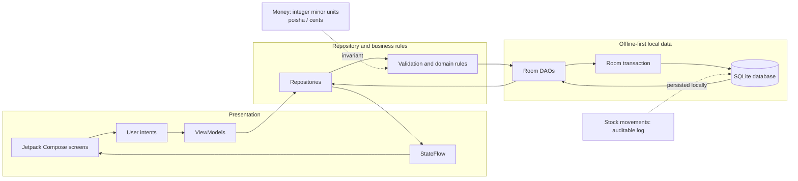
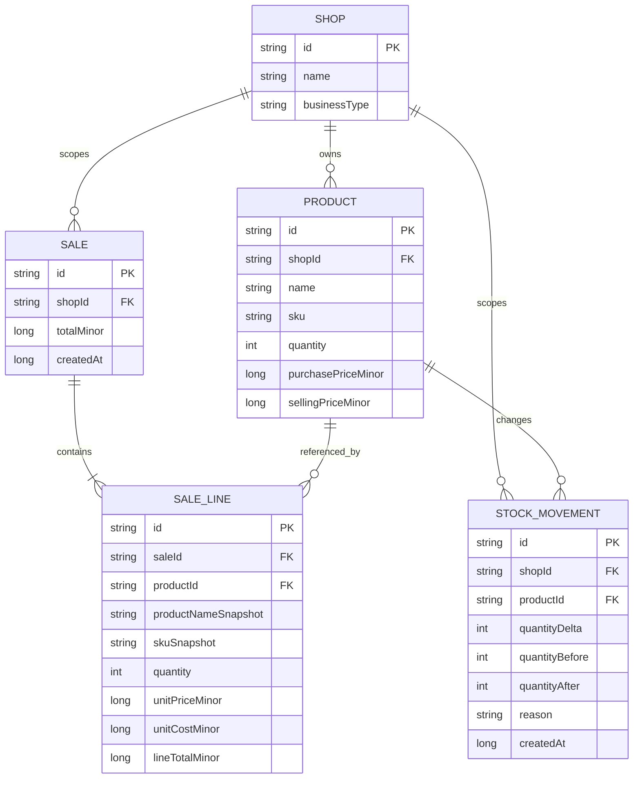
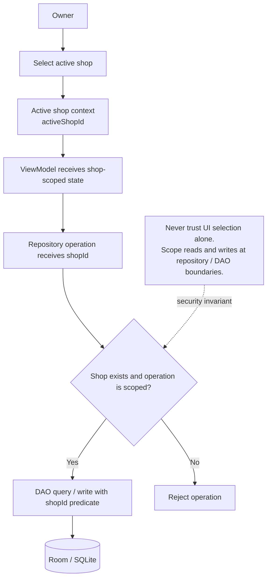

# Vendora Architecture Diagrams

These portable Mermaid diagrams document the offline-first architecture and transaction invariants. The entity model is explicitly a target model where noted; it is not a claim about the exact current Room schema.

## 1. System architecture and unidirectional data flow



**UDF:** user actions flow toward repositories; database results flow back through repository observations and `StateFlow` as immutable UI state. Core operations do not require network access.

## 2. Atomic checkout sequence

```mermaid
sequenceDiagram
    autonumber
    actor Cashier
    participant UI as Compose Sell screen
    participant Repo as Checkout repository
    participant Tx as Room transaction
    participant DAO as Room DAO
    participant DB as SQLite
    Cashier->>UI: Confirm cart
    UI->>Repo: checkout(activeShopId, cart)
    Repo->>Repo: Validate non-empty cart and positive quantities
    Repo->>Tx: Begin withTransaction
    loop Every cart line
        Tx->>DAO: Load product by activeShopId and productId
        DAO->>DB: SELECT scoped product
        DB-->>DAO: Product and current stock
        DAO-->>Tx: Product record
        Tx->>Tx: Check existence, shop scope, stock, and prices
    end
    alt Missing product or insufficient stock
        Tx-->>Repo: Raise validation error
        Repo-->>UI: Reject with product and available quantity
        Note over Tx,DB: Roll back; no partial sale, stock update, or movement persists
    else All cart lines valid
        Tx->>Tx: Freeze name, SKU, quantity, unit price, unit cost
        Tx->>Tx: Calculate totals with checked integer minor-unit arithmetic
        loop Each prepared line
            Tx->>DAO: Insert sale-line snapshot
            DAO->>DB: INSERT sale line
            Tx->>DAO: Decrement product stock
            DAO->>DB: UPDATE product quantity
            Tx->>DAO: Append movement with before/after and negative delta
            DAO->>DB: INSERT stock movement
        end
        Tx->>Tx: Commit transaction
        Tx-->>Repo: Checkout result
        Repo-->>UI: Success and total
        UI-->>Cashier: Show completed checkout
    end
```

**Atomicity:** sale-line writes, stock decrements, and stock-movement inserts belong inside the same transaction. Any validation failure or exception must roll back all writes. A low-stock warning is informational; it must never bypass stock validation.

## 3. Entity-relationship model

The diagram below is the **logical target model**. The current Room schema may not yet include a separate `Sale` header or declared foreign-key constraints. Implement those only through deliberate schema changes and migrations.



Money fields use integer minor units (poisha/cents). Sale-line snapshots preserve historical values even if the product catalog changes later.

## 4. Active-shop isolation



Every shop-owned read and write must carry an explicit shop identifier. Product lookup, checkout validation, stock movement history, and reports must not silently fall back to unscoped queries. Tests should verify that a product or cart from one shop cannot be read or mutated through another shop's context.
