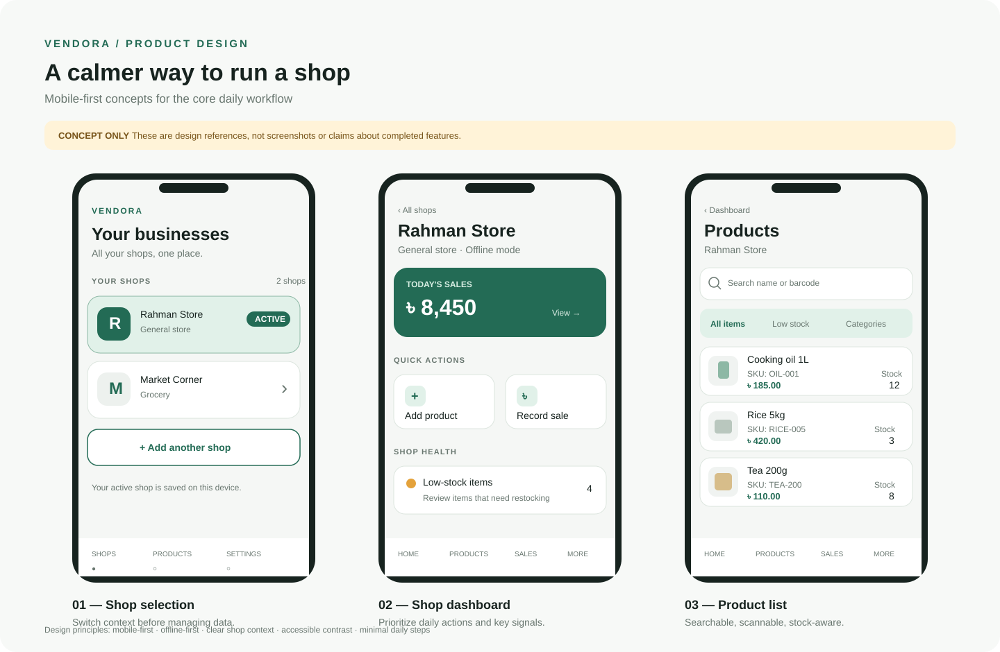
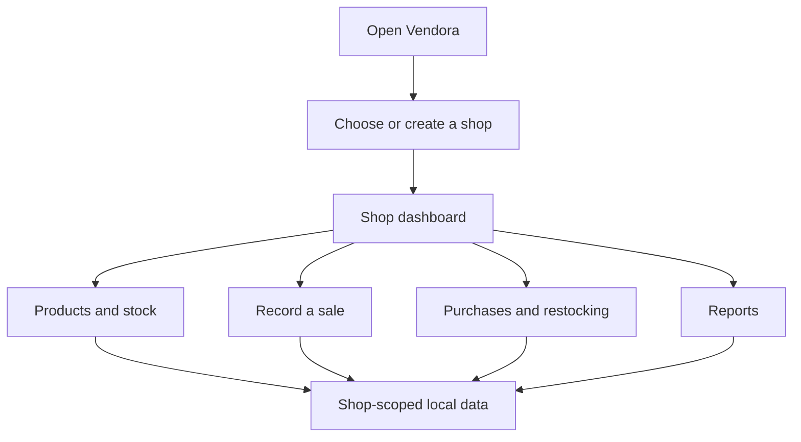

# UI concepts

These visual concepts make the product direction concrete before we implement each screen. They are **design references, not screenshots of the current app**. Labels, sample figures, and sample products are illustrative only.

## Screen 1 — Shop selection

**Purpose:** Make it obvious which business the user is working in.

- Show each shop as a clear selectable card.
- Mark the active shop with text and a visual treatment, not color alone.
- Keep creating another shop easy to find.
- Explain that the active shop is currently stored on the device.

**Implementation status:** Shop creation and selection exist. Navigation into a shop dashboard is not implemented yet.

## Screen 2 — Shop dashboard

**Purpose:** Give the user a useful starting point for daily work.

- Keep the current shop name visible.
- Put frequent actions such as adding a product and recording a sale near the top.
- Use sales and low-stock summaries only when backed by real local data.
- Avoid fake metrics or decorative charts in the production app.

**Implementation status:** Planned concept. The amounts and counts in the illustration are placeholders.

## Screen 3 — Product list

**Purpose:** Find products quickly and spot stock problems.

- Search by product name, SKU, or barcode.
- Make price and stock quantity easy to scan.
- Highlight low-stock state with text or an icon as well as color.
- Keep product actions reachable on small screens.

**Implementation status:** Planned concept. The sample products and values are illustrative.

## Shared design principles

1. **Mobile first:** prioritize narrow screens, thumb reach, and short workflows.
2. **Offline first:** core inventory and sales workflows must remain useful without a network.
3. **Shop isolation:** every inventory operation must use the active shop's explicit ID.
4. **Honest UI:** show empty, loading, and error states; never present placeholder figures as real business data.
5. **Accessible:** readable type, sufficient contrast, descriptive controls, and non-color-only status indicators.
6. **Incremental delivery:** implement one end-to-end flow at a time and test it before adding more surface area.

## Proposed user journey

This is a product direction, not a claim that all destinations are available today.
